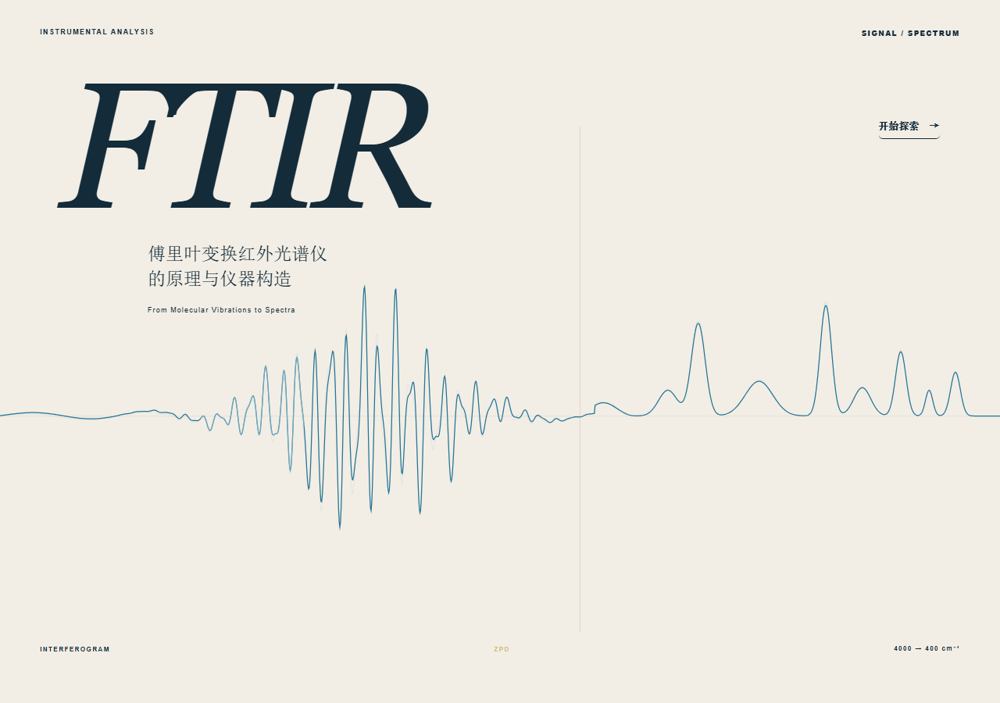
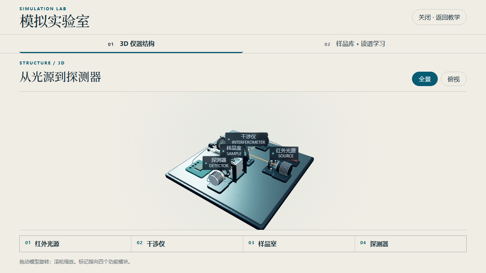
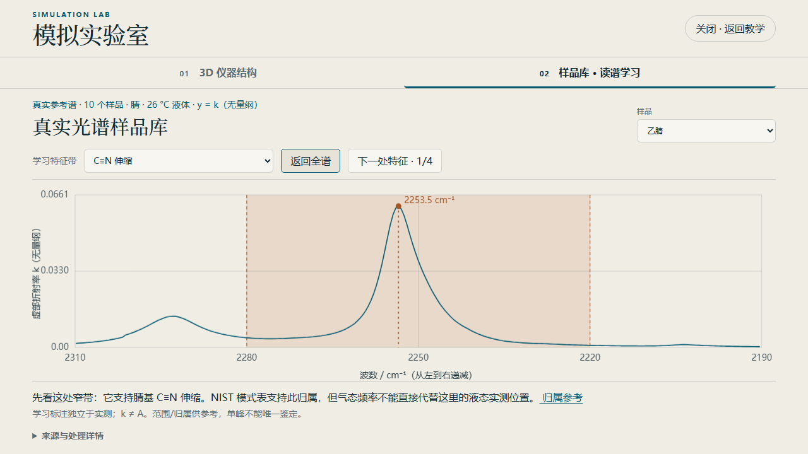
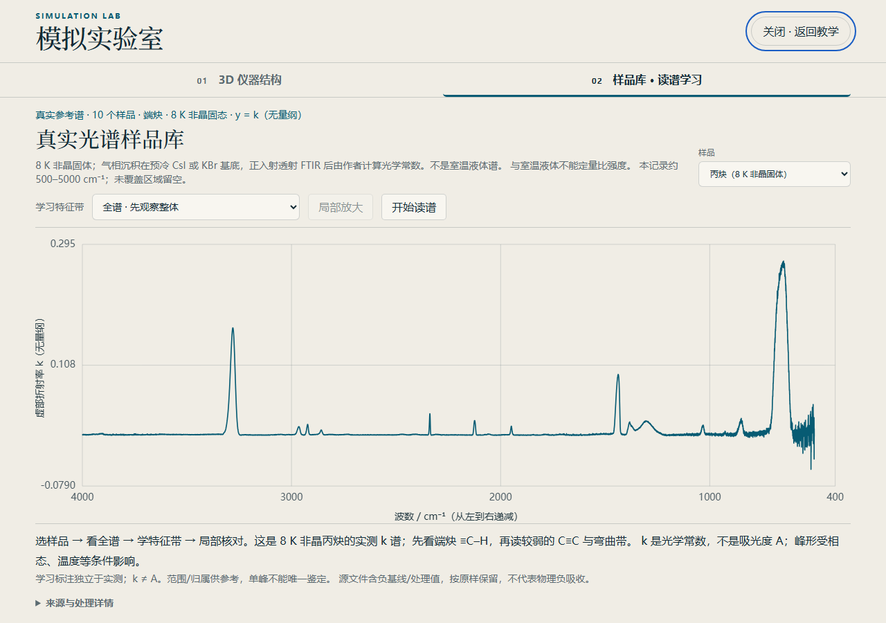

# FTIR · 从信号到光谱

面向第一次接触红外光谱的大学生，以约五分钟的科学解释主线串起：**分子选择性吸收 → Michelson 光程差编码 → 干涉图记录 → Fourier 变换 → 背景参比 → 分子结构线索**。适合课堂投影、逐步讲解和课后探索。

课堂动画采用理想模型与合成数据；末尾模拟实验室中的真实参考谱另行标注来源、相态、温度、坐标量和处理信息。网页不是实物 FTIR 的操作规程。



## 直接离线使用

下载 [FTIR课堂单文件版.html](dist/FTIR课堂单文件版.html)，保存到电脑后，用现代桌面浏览器双击打开。课堂代码、Three.js、GSAP 和 10 个参考谱已经内嵌；可把这一文件单独拷贝到其他文件夹或电脑运行，无需安装依赖或联网。

来源链接用于进一步查阅，打开外部来源需要网络。三维视图需要浏览器支持 WebGL；无法显示三维时提供结构文字，教学主线与读谱学习仍可使用。

## 六分钟双语影片

[FTIR_final_bilingual.mp4](film/video/FTIR_final_bilingual.mp4) 为六分钟 1080p/30 fps 影片，包含烧录的中英字幕和连续音乐；[影片说明](film/README.md) 保留制作自审与限制，[源码及重现方法](film/source/README.md) 提供独立的 Remotion 源码快照。

MP4 使用 Git LFS。安装 Git LFS 后再克隆本仓库；若已有 checkout 或下载后只有小型指针文件，在仓库目录执行 `git lfs pull` 获取真实视频。不要在视频旁放置同名 SRT，以免播放器叠加外部字幕；可编辑字幕保留在影片源码的 docs 中。

## 课堂操作

| 操作 | 功能 |
| --- | --- |
| 首页“开始探索” | 进入课堂主线 |
| 点击舞台空白处 / `Space` / `→` | 播放下一步，完成后停留；动画期间忽略重复推进 |
| `←` | 返回前一稳定停点 |
| `R` | 重播当前场景 |
| 末尾“进入模拟实验室” | 打开三维仪器与样品库，支持 Tab 聚焦后 Enter 进入 |
| 实验室 `Tab` / `Shift+Tab` | 在弹窗控件之间移动焦点 |
| 实验室 `Escape` | 关闭实验室，回到课堂入口焦点 |

控件操作与课堂推进隔离，滚轮不推进教学。讲者可以随时停下来讨论。舞台按 16:9 整体缩放；桌面横屏更适合展示。可配合 [五分钟课堂讲稿](docs/teaching/五分钟课堂讲稿.md)、[打印版 PDF](docs/teaching/FTIR五分钟课堂讲稿.pdf) 和 [备课知识与答疑](docs/teaching/备课知识与答疑.md)。

## 仪器与读谱实验室

三维仪器保留光源、干涉仪、样品室与探测器的空间关系，可切换全景和俯视，并拖动旋转、滚轮缩放。



真实参考库包含 **10 个样本、47 个读谱特征**：丙酮、乙醇、液态苯乙烯低聚物、辛酸、乙酸甲酯、乙腈、叔丁胺、正辛烷、苯乙烯单体和丙炔。每条曲线直接绘制本地实测记录；特征区间和解释是独立标注层。可以看全谱、按顺序学习特征带、局部放大，再回到全谱核对。



读谱时保留这些边界：

- 纵轴为**虚部折射率 k（无量纲）**，不是吸光度 A、透射率 T 或吸收系数；不同样本峰高不能直接比较浓度。
- 丙炔是 **8 K 非晶固体冰**的光学常数，不代表室温气态或液态丙炔。原始负基线/处理值逐点保留，不代表物理负吸收；原文报告的 CO₂ / 丙二烯杂质也没有删去。
- `polystyrene` 记录的真实样品是**液态苯乙烯低聚物**，不是室温固态聚苯乙烯薄膜；苯乙烯单体是另一条独立样品。NIST SRM 1921b 认证峰位表是校准对象，不是完整实测谱。
- 宽包络窗口最大值不等于孤立振动模式。单峰不能唯一鉴定物质，应联合多处特征并核对相态、温度和测量条件。
- 发布者已做光学常数计算与测量处理。“不平滑、不归一化、不插值”等描述本项目追加处理，不代表上游数据未经处理。



## 运行和构建源码

需要 Node.js 20 或更高版本。项目使用原生 HTML/CSS/JavaScript；构建与本地服务器只依赖 Node 内置模块，**不需要 `npm install`、API key 或 React/Vite**。

```sh
npm run serve
```

浏览器打开 `http://127.0.0.1:4173/`。可用 `npm run serve -- 8080` 指定端口。

```sh
npm run build
npm run validate
```

`build` 根据根目录 `index.html` 的实际加载顺序生成 `dist/FTIR课堂单文件版.html`；`validate` 检查目录数量、原始数组与特征峰值、脚本语法、离线代码及内嵌 JSON 与源文件一致性，并更新验证报告 `docs/verification/static-results.json`。每次修改源码或参考库后都应重新构建。

如果环境只有 Node、没有 npm，也可直接执行：

```sh
node scripts/serve.mjs
node scripts/package-single-html.mjs
node scripts/validate.mjs
```

可选浏览器验收脚本为 `scripts/verify-browser.mjs`，需自行提供已有的 Playwright 模块和 Chrome 路径；它不是运行课堂的依赖。验收范围与限制见 [verification](docs/verification/README.md)。上传方法见 [GitHub 上传说明](docs/GITHUB_UPLOAD.md)。

## 文件结构

| 路径 | 用途 |
| --- | --- |
| `index.html` 与根目录 JS/CSS | 当前运行入口、模型、教学状态和绘制代码 |
| `dist/FTIR课堂单文件版.html` | 可独立移动的离线课堂成品，可提交到 Git |
| `reference-data/` | 原始来源、processed 数组、catalog、归属依据、转换脚本与验证报告 |
| `vendor/` | 本地固定版本运行库、来源说明与现有许可 |
| `scripts/` | 无依赖服务器、打包、数值/包装校验与可选浏览器验收 |
| `docs/` | 功能截图、课堂讲稿、验证记录和上传说明 |
| `film/` | 六分钟双语 MP4（Git LFS）、完整影片源码快照、音乐与哈希清单 |
| `AGENTS.md` / `DESIGN.md` | 项目协作规则与设计背景；历史段落不表示当前已验收 |

历史原型、重复入口、React/Vite 模板、浏览器配置和大型旧 QA 材料已移到项目外。整理范围与恢复位置见 [整理记录](docs/verification/CLEANUP.md)。

## 数据来源与权利归属

完整来源、每个样本的条件、处理和许可见 [reference-data/README.md](reference-data/README.md)、[manifest](reference-data/manifest.json) 与各条 processed 记录。主要来源为：

- [PNNL Liquids n/k Dataset，DOI 10.25584/2997107](https://doi.org/10.25584/2997107)：丙酮、乙醇，源数据标注 CC0 1.0，保留引用。
- [NIST Chemistry WebBook 中的 PNNL/IARPA 记录](https://webbook.nist.gov/chemistry/)：指定液态样本的单条 JCAMP `OWNER=Public domain`；此声明只适用于保留的指定记录，不泛化到 NIST 站点的其他编译资料。
- [NASA Cosmic Ice Laboratory](https://science.gsfc.nasa.gov/691/cosmicice/constants.html)：丙炔 8 K 非晶光学常数；保留 [Hudson 等（2021）论文引用](https://doi.org/10.1016/j.icarus.2020.114033) 与 [NASA OCdb 数据再分发条款](https://ocdb.smce.nasa.gov/page/toc)。不是 CC0 声明，也不授权复制出版社论文。

Three.js / OrbitControls 保留 [MIT 许可](vendor/THREE-LICENSE.txt)。GSAP 3.13.0 和伴随插件保留原始文件头及 [GSAP Standard License](https://gsap.com/standard-license)，来源记录见 [vendor/README.md](vendor/README.md)。第三方代码与参考资料按各自条款使用，不随应用代码重新授权。

本仓库未为原创应用代码授予统一的开源许可证；公开上传不等于额外授权。若需再发布或商业使用，应先确认原创代码授权，并分别遵守数据和第三方组件条款。

已知溯源限制：旧丙酮、乙醇 ASCII 文件的实际 SHA-256 与历史 manifest 声明不同，但直接读取的全部 x/k 数值与冻结 processed 数组逐点相同；旧声明和差异说明均保留。低聚物样本温度仍未由原始记录确认。详情见数据 README，不能把这些项目标为历史 hash 全部通过。
